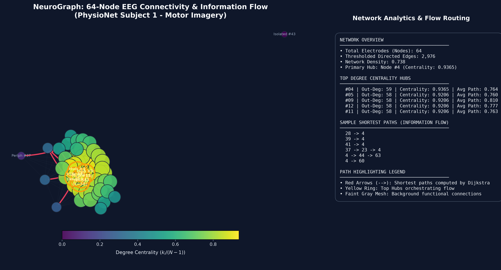

# NeuroGraph

An end-to-end computational neuroscience pipeline for constructing, analyzing, and visualizing functional brain connectivity networks from high-density EEG recordings.



---

## Overview

**NeuroGraph** integrates neuroelectrophysiology with graph theory and high-performance C++ systems programming:

1. **EEG Data Pipeline (`process_eeg.py`)**:
   - Downloads and preprocesses 64-channel EEG recordings from the **PhysioNet EEG Motor Movement/Imagery Dataset** (Subject 1, Run 4) using `mne`.
   - Computes a $64 \times 64$ Pearson cross-correlation functional connectivity matrix via `numpy`.
   - Exports the unweighted adjacency structure to `eeg_adjacency_matrix.csv`.

2. **Graph Engine (`graph_engine.cpp`)**:
   - Implemented in modern C++ utilizing the **Standard Template Library (STL)**.
   - Populates a dense 2D adjacency representation (`std::vector<std::vector<double>>`).
   - Applies an edge weight threshold ($r \ge 0.50$) to construct a weighted directed graph (`std::vector<std::vector<Edge>>`).
   - Implements **Dijkstra's Algorithm** with `std::priority_queue` to compute all-pairs shortest paths.
   - Computes topological network metrics: out-degree, degree centrality, weighted degree (strength), mean shortest path distance, and closeness centrality.
   - Exports network metrics to `topological_metrics.csv`.

3. **Topology & Information Flow Visualizer (`visualize_graph.py`)**:
   - Uses `NetworkX` and `matplotlib` to render a 64-node network diagram.
   - Scales and colors nodes by degree centrality (`viridis`), highlighting key motor cortex hubs (`Fc2`, `Fc4`, `C1`, `Cz`, `C2`).
   - Highlights directional Dijkstra shortest paths to visualize functional information flow from peripheral sensors to primary hubs.

---

## Project Structure

```
NeuroGraph/
├── process_eeg.py              # EEG acquisition & cross-correlation matrix generator
├── graph_engine.cpp            # High-performance C++ graph engine (STL Dijkstra & metrics)
├── visualize_graph.py          # NetworkX / Matplotlib graph & flow visualizer
├── requirements.txt            # Python dependencies (mne, numpy, pandas, matplotlib, networkx)
├── eeg_adjacency_matrix.csv    # 64x64 correlation matrix (exported data)
├── topological_metrics.csv     # Calculated topological & shortest path metrics
├── neurograph_visualization.png# Publication-quality network visualization
├── .gitignore
└── README.md
```

---

## Installation & Setup

### 1. Environment Setup
```bash
# Clone the repository
git clone https://github.com/RipunjaySainii/NeuroGraph.git
cd NeuroGraph

# Set up Python virtual environment
python3 -m venv env
source env/bin/activate
pip install -r requirements.txt
```

### 2. Generate Adjacency Matrix
```bash
python process_eeg.py
```

### 3. Compile and Run C++ Graph Engine
```bash
# Compile graph engine
g++ -std=c++17 -Wall -Wextra -O3 -o graph_engine graph_engine.cpp

# Run with default threshold (0.50)
./graph_engine

# Or specify a custom threshold: ./graph_engine [threshold] [input.csv] [output.csv]
./graph_engine 0.45 eeg_adjacency_matrix.csv topological_metrics.csv
```

### 4. Visualize Graph & Shortest Paths
```bash
python visualize_graph.py
```
The output visualization is saved as `neurograph_visualization.png`.

---

## Key Results

- **Primary Hub**: Node 4 (`Fc2`, Premotor / Motor Cortex) with Degree Centrality = **0.9365** (Degree 59).
- **Core Hub Cluster**: Frontocentral electrodes (`Fc2`, `Fc4`, `C1`, `Cz`, `C2`) act as the central routing backbone for motor imagery tasks.
- **Network Density**: 0.738 (2,976 directed edges at $r \ge 0.50$).

---

## License
MIT License.
